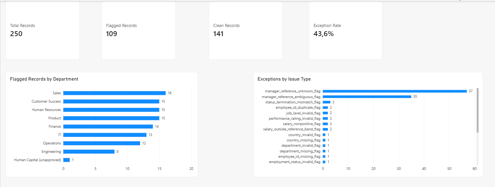
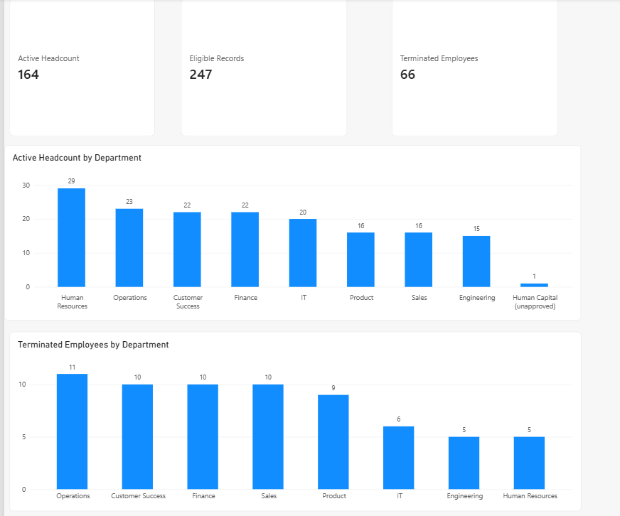

HRIS Data Quality & People Reporting
An independent portfolio project using SQL, SQLite, Power Query, Power BI, and DAX to audit synthetic HR information and prepare transparent workforce reporting metrics.
> **Project status:** Completed — portfolio version. The Power BI report is documented with static screenshots; a public Power BI Service link has not been added.
Project Overview
HR teams rely on employee data for workforce reporting and operational decisions. Missing identifiers, duplicate employee IDs, invalid dates, inconsistent employment statuses, unexpected department values, and unresolved manager references can reduce confidence in reports.
This project demonstrates a practical workflow for identifying HRIS data-quality exceptions, documenting findings, and presenting selected workforce metrics. The dataset is synthetic and contains deliberately introduced issues; it does not represent a real organisation.
Objectives
Assess completeness, validity, and consistency in employee records.
Identify missing and duplicate employee IDs and other data-quality exceptions.
Check hire and termination dates, employment status, salary values, job levels, and manager references.
Produce a traceable exception overview without silently changing the source dataset.
Define transparent eligibility rules for basic People Reporting metrics.
Present the audit and reporting results in a two-page Power BI dashboard.
Tools
SQLite / DB Browser for SQLite — SQL profiling and validation.
Power Query — import and presentation transformations.
Power BI — dashboard visuals.
DAX — reporting measures.
Dataset and Method
The source dataset contains 250 synthetic employee records. The raw table `employees_raw` was preserved during SQL profiling. The SQL script creates a temporary quality view, `v_employees_quality`, with record-level flags and derived fields used in the audit.
The implemented controls are organised into seven areas:
Employee ID uniqueness and completeness.
Required-field completeness and approved values.
Hire and termination date validity.
Consistency between employment status and termination date.
Salary validity and illustrative reference bands.
Job-level and performance-rating checks.
Manager-reference consistency.
The salary bands are illustrative synthetic validation rules, not market benchmarks. Date checks use the fixed as-of date 26 October 2026 to make the SQL results reproducible.
SQL Audit Results
The initial SQL audit executed successfully in SQLite.
Metric	Result	Definition
Total employee records	250	All source rows analysed
Records flagged by at least one rule	109	Rows where at least one implemented quality flag is set
Records with no implemented rule triggered	141	Rows where `has_any_issue_flag = 0`
Data-quality exception rate	43.6%	Flagged source rows divided by all source rows (`109 / 250`)
Exception types with non-zero counts	24	Implemented individual checks with at least one occurrence
These are row counts, not a count of every individual issue. A row can trigger more than one rule; therefore, counts by issue type should not be summed to infer the number of unique affected records. A row with no flag is not guaranteed to be completely error-free; it means only that none of the implemented rules was triggered.
Key Findings
57 records contain manager references that could not be matched to an employee in the supplied dataset.
35 records contain ambiguous manager references to `EMP0006`, an employee ID that appears in two source rows.
1 self-referencing manager relationship was identified.
3 records were flagged for an employment-status and termination-date inconsistency.
The audit also identified missing required values, invalid dates or statuses, invalid job levels, non-positive salaries, salaries outside illustrative reference bands, and an unapproved department value (`Human Capital`).
An unmatched manager reference is not automatically proof of incorrect data; it may refer to a person outside the supplied dataset. Exceptions should be investigated against an authoritative source before any source-data correction is made.
See the detailed data-quality findings for the findings and recommended follow-up actions.
People Reporting Metrics
The Power BI report includes the following measures:
Metric	Result	Definition
Total records	250	All source rows
Eligible records	247	Rows with a non-missing, non-duplicated `EmployeeID`
Active headcount	164	Distinct eligible employee IDs whose status is `Active`
Terminated employees	66	Distinct eligible employee IDs whose status is `Terminated`
Flagged records	109	Rows with at least one quality flag
Records with no detected exceptions	141	Rows where `has_any_issue_flag = 0`
Data-quality exception rate	43.6%	Flagged rows divided by all source rows
For People Reporting, an employee row is eligible only when `employee_id_missing_flag = 0` and `employee_id_duplicate_flag = 0`. Other quality flags are retained for investigation and are not automatically excluded from headcount. The active and terminated counts are distinct-ID measures and refer to the status values in this synthetic dataset; they are not turnover or attrition rates.
Power BI Dashboard
01 — Data Quality Overview

This page presents total records, flagged records, records with no detected exceptions, and exception rate. It also shows flagged records by department and exception counts by issue type.
02 — People Reporting

This page presents eligible records, active headcount, terminated employees, active headcount by department, and terminated employees by department.
Department presentation note
In the Power BI presentation layer, the missing department for `EMP0017` is displayed as Human Resources for illustrative reporting purposes, based on the employee's `HR Assistant` job title. This is an assumption, not a verified source-data correction. The original `Department` value remains missing, and the original data-quality flag is preserved. The source CSV and SQL audit results should not be interpreted as having been corrected by this display-only mapping.
The value `Human Capital` is shown as unapproved because it falls outside the department values allowed by the implemented validation rule. It is retained in the visual rather than hidden.
Key DAX Measures
The measures below are used by the report. They assume the imported table is named `employees_quality_export`.
Total Records
```dax
Total Records =
COUNTROWS('employees_quality_export')
```
Flagged Records
```dax
Flagged Records =
CALCULATE(
    [Total Records],
    KEEPFILTERS(
        'employees_quality_export'[has_any_issue_flag] = 1
    )
)
```
Clean Records
```dax
Clean Records =
CALCULATE(
    [Total Records],
    KEEPFILTERS(
        'employees_quality_export'[has_any_issue_flag] = 0
    )
)
```
Exception Rate
```dax
Exception Rate =
DIVIDE([Flagged Records], [Total Records], 0)
```
Format this measure as a percentage.
Eligible Records
```dax
Eligible Records =
CALCULATE(
    COUNTROWS('employees_quality_export'),
    KEEPFILTERS(
        'employees_quality_export'[employee_id_missing_flag] = 0
    ),
    KEEPFILTERS(
        'employees_quality_export'[employee_id_duplicate_flag] = 0
    )
)
```
Active Headcount
```dax
Active Headcount =
CALCULATE(
    DISTINCTCOUNT('employees_quality_export'[EmployeeID]),
    KEEPFILTERS(
        'employees_quality_export'[EmploymentStatus] = "Active"
    ),
    KEEPFILTERS(
        'employees_quality_export'[employee_id_missing_flag] = 0
    ),
    KEEPFILTERS(
        'employees_quality_export'[employee_id_duplicate_flag] = 0
    )
)
```
Terminated Employees
```dax
Terminated Employees =
CALCULATE(
    DISTINCTCOUNT('employees_quality_export'[EmployeeID]),
    KEEPFILTERS(
        'employees_quality_export'[EmploymentStatus] = "Terminated"
    ),
    KEEPFILTERS(
        'employees_quality_export'[employee_id_missing_flag] = 0
    ),
    KEEPFILTERS(
        'employees_quality_export'[employee_id_duplicate_flag] = 0
    )
)
```
Repository Structure
```text
hris-data-quality-people-reporting/
├── data/
│   ├── employees_raw.csv
│   ├── hris_data_dictionary.md
│   └── sql/
│       ├── 01_data_quality_profile.sql
│       └── README.md
├── reports/
│   └── data_quality_findings.md
├── screenshots/
│   ├── README.md
│   ├── 01_data_quality_overview.png
│   └── 02_people_reporting.png
└── README.md
```
`data/` — synthetic source dataset and data dictionary.
`data/sql/` — SQL profiling and validation script, plus SQL usage notes.
`reports/` — detailed audit findings and recommended follow-up actions.
`screenshots/` — static captures of the two Power BI report pages.
`README.md` — project overview, results, methodology, measures, and dashboard screenshots.
Limitations and Data Privacy
All records are synthetic and intended for learning and portfolio demonstration.
Quality flags identify records requiring review; they do not establish that records are factually incorrect.
The source dataset was preserved during SQL checks. The `Department Display` mapping for `EMP0017` is a presentation-only assumption and must not be mistaken for a verified correction.
Salary reference bands are illustrative and are not market benchmarks.
The dashboard is documented with static screenshots. A public interactive Power BI Service link is not included in this repository version.
Project Files
SQL data-quality profile
SQL usage notes
Detailed data-quality findings
Source synthetic employee dataset
Data dictionary
---
This project demonstrates an auditable workflow from HR data validation to workforce reporting, with explicit definitions, transparent assumptions, and documented limitations.
